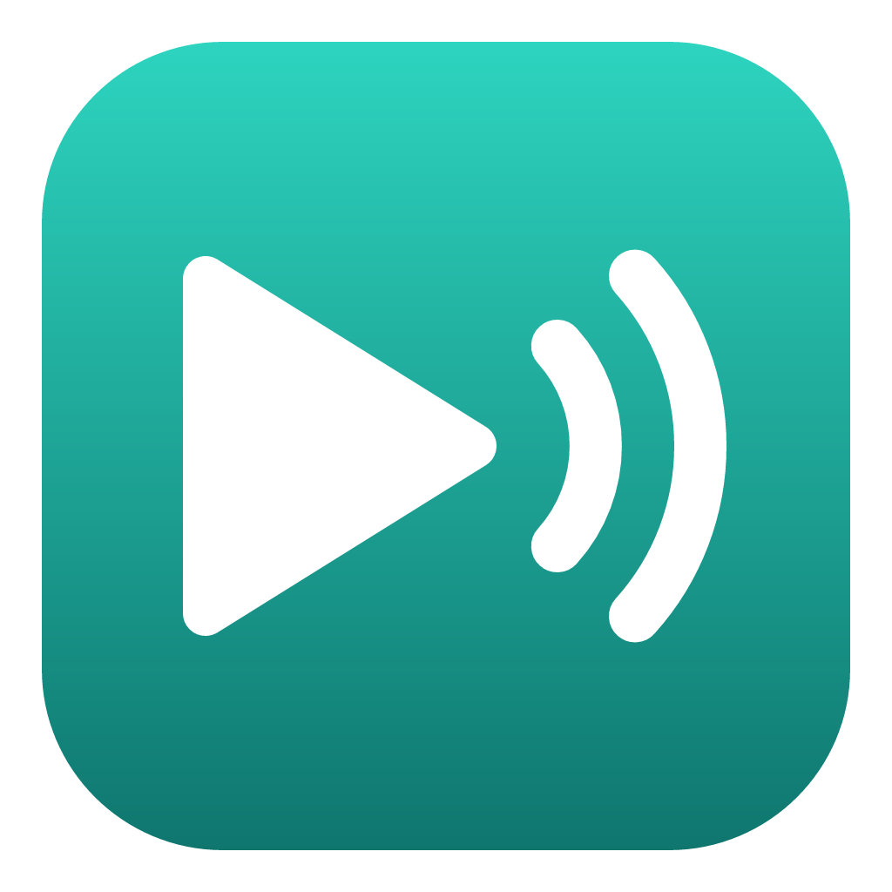
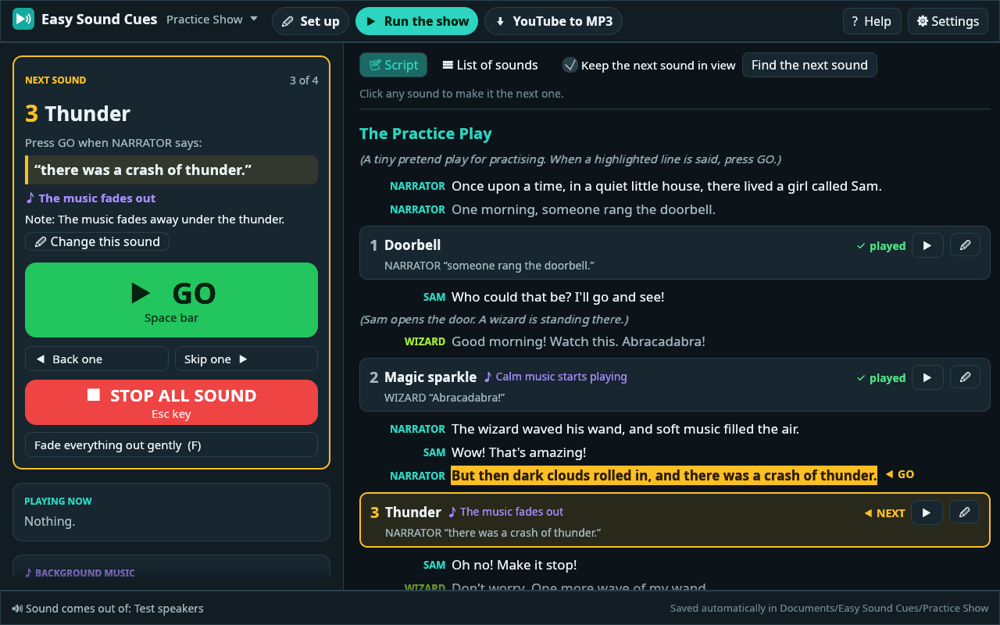
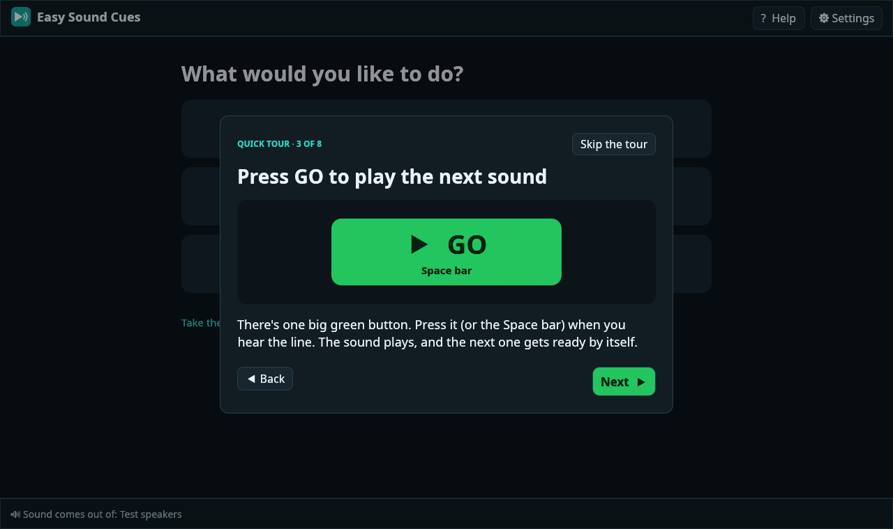
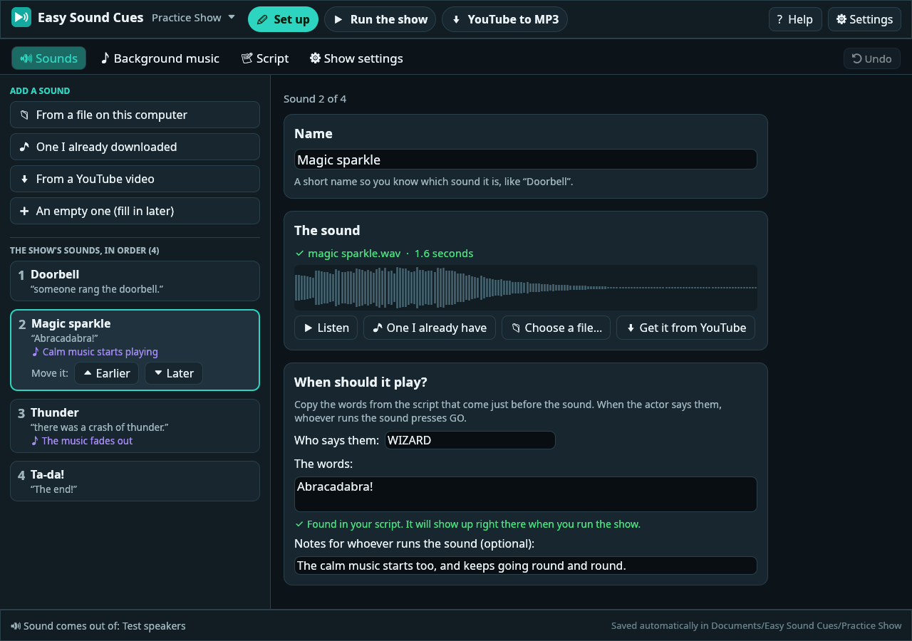
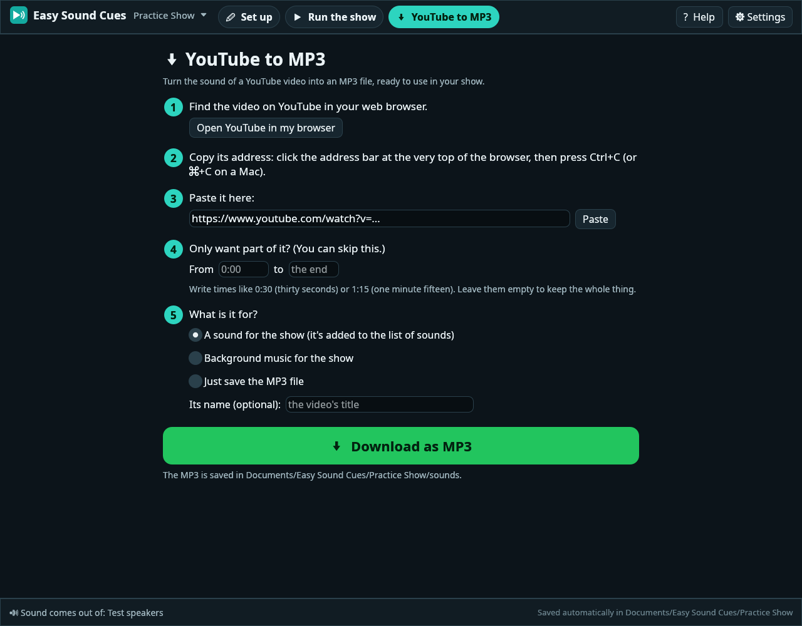

<p align="center"></p>

<h1 align="center">Easy Sound Cues</h1>

<p align="center"><b>Plays the sound effects and music for your play, one button press at a time.</b><br>
Free, for Windows, Mac and Linux. Made for people who don't like computers.</p>



A doorbell, a crash of thunder, a song under a scene: you put your show's sounds in order and type
the line each one comes after. During the performance the app shows you the next sound and the
words to listen for. When the actor says them, you press the big green **GO** button. That's it.

- **One big button.** GO plays the next sound; the one after it gets ready by itself.
- **One big STOP button.** If anything goes wrong, everything goes quiet at once.
- **Follow the script.** Paste in your script and each sound appears right where it happens.
- **Background music.** Songs can loop quietly under a scene and fade from one into the next.
- **YouTube to MP3, built in.** Paste a link and the app makes an MP3 for your show.
- **Nothing to set up by hand.** On first launch it checks your computer and gets what it needs.
- **Saves itself.** No save button to forget, and an Undo button for second thoughts.
- **Keeps itself up to date.** When there's a new version, it offers to update with one click.

## Download it

| Your computer | Click to download |
| --- | --- |
| **Windows** 10 or 11 | [**Easy-Sound-Cues-Windows.exe**](https://github.com/ESP32-S3/easy-sound-cues/releases/latest/download/Easy-Sound-Cues-Windows.exe) |
| **Mac** (Apple Silicon or Intel, macOS 10.13 or newer) | [**Easy-Sound-Cues-Mac.dmg**](https://github.com/ESP32-S3/easy-sound-cues/releases/latest/download/Easy-Sound-Cues-Mac.dmg) |
| **Linux** (64-bit) | [**Easy-Sound-Cues-Linux.tar.gz**](https://github.com/ESP32-S3/easy-sound-cues/releases/latest/download/Easy-Sound-Cues-Linux.tar.gz) |

Older versions are on the [releases page](https://github.com/ESP32-S3/easy-sound-cues/releases).

## Opening it for the first time

The first time you open it, your computer will probably warn you about the app. That's normal for
free apps: Microsoft and Apple charge developers every year to "sign" their apps, and this one
isn't signed. You only have to get past the warning once.

### On Windows

1. Open your **Downloads** folder and double-click **Easy-Sound-Cues-Windows.exe**.
   (Tip: drag it onto your Desktop first, so it's easy to find next time.)
2. If a blue box says **“Windows protected your PC”**, click **More info**, then **Run anyway**.
3. The app opens and says hello.

### On a Mac

1. Double-click **Easy-Sound-Cues-Mac.dmg** in your Downloads. A small window opens.
2. In that window, drag **Easy Sound Cues** onto the **Applications** folder.
3. Open your **Applications** folder and double-click **Easy Sound Cues**.
4. If the Mac says the app **can't be opened** or **“Apple could not verify”** it, click **Done** (or **OK**). Then:
   - open the Apple menu  › **System Settings** › **Privacy & Security**,
   - scroll down to the message about Easy Sound Cues, click **Open Anyway**, and type your password if asked.

   On older Macs you can instead right-click (or Control-click) the app, choose **Open**, then click **Open** again.

### On Linux

1. Unpack **Easy-Sound-Cues-Linux.tar.gz** (double-click it, or right-click › Extract).
2. In the folder that appears, run **install.sh** (right-click › Run as a program, or type `./install.sh` in a terminal there).
3. Easy Sound Cues is now in your apps menu.

## How to use it

The app explains everything as you go, and there's a short tour the first time you open it. You
can see the tour again any time from **? Help**. Here's the whole thing in five steps.



### 1. Let it check your computer

On first launch the app checks that your speakers work and that it can save your shows. For the
YouTube to MP3 tool it also needs three free helper programs. If they're missing, press
**Get everything I need** and wait a minute or two. It's all automatic.

### 2. Try the practice show

Choose **Try the practice show**. It's a tiny pretend play with four made-up sounds. Press the big
green **GO** button (or the Space bar) each time a highlighted line comes up, and see what happens.

### 3. Make your own show

Choose **Make a new show** and give it a name. Then, in **✏ Set up › 🔊 Sounds**, add your sounds:

- **From a file on this computer** for sounds you already have (MP3, WAV, M4A, OGG or FLAC),
- **One I already downloaded** for a list of the sound files already on your computer,
- **From a YouTube video** to turn a YouTube video into an MP3.

Click a sound in the list to change it. Under **When should it play?**, type who says the line and
the words just before the sound. Use **Move it: Earlier / Later** to put the sounds in order.



For background music, use **♪ Background music**, then pick which sound starts the music (and
which one stops it) under **Background music** in that sound's settings.

To have each sound shown right where it happens in your script, paste the script into the
**📝 Script** tab. Write speakers like `NARRATOR: Once upon a time…`, stage directions in brackets,
and headings starting with `#`.

### 4. Get sounds from YouTube

Open **⬇ YouTube to MP3** and follow the five numbered steps: find the video, copy its address,
paste it in, choose (if you like) just the part you want, and press **Download as MP3**. The MP3
goes straight into your show.



### 5. Run the show

Open **▶ Run the show**. The box on the left always shows the **next sound** and the **words to
listen for**. When you hear them, press **GO**.

| Key | What it does |
| --- | --- |
| **Space** (or Enter, or Page Down) | GO: play the next sound. A wireless presentation clicker works too. |
| **Esc** | Stop all sound, right now |
| **F** | Fade everything out gently |
| **M** | Fade the music out |
| **← →** | Go back one sound / skip one |

Pressed GO twice by accident? A second press within half a second is ignored, so you can't skip a
sound by mistake. Clicked the wrong thing? Click any sound in the list to make it the next one.

## Moving a show to another computer

Every show is saved by itself in **Documents › Easy Sound Cues**, with copies of all its sounds.
To use it on another computer (for example, the one at the theatre):

1. Click the show's name at the top of the window, then **📦 Save a copy for another computer**.
   This makes one `.zip` file with everything inside it. Put it on a USB stick or email it.
2. On the other computer, install Easy Sound Cues, choose **Open a show someone gave me**, and pick
   that `.zip` file.

If some of a show's sounds are missing, a yellow bar says so, and **Fix it now** shows each one
with buttons to give it a file.

## Questions

<details>
<summary><b>I can't hear anything.</b></summary>

Check the speakers are plugged in and switched on, and the computer's own volume is up. Then open
**⚙ Settings** and press **Reconnect the speakers** and **Play a test sound**. If the computer has
more than one set of speakers, choose the right ones under **Speakers**.
</details>

<details>
<summary><b>A YouTube download doesn't work.</b></summary>

Check the computer is online (some school and office networks block YouTube; a phone hotspot may
work). Press **Update the downloader**: YouTube changes often and the newest version usually fixes
it. Private, age-restricted and live videos can't be downloaded at all.
</details>

<details>
<summary><b>Do I need to press Save?</b></summary>

No. Every change is saved straight away. **⟲ Undo** (or Ctrl+Z) takes back adding, removing or
moving a sound.
</details>

<details>
<summary><b>The sounds are all different volumes.</b></summary>

Leave **Make it about as loud as the other sounds** ticked (it is, unless you untick it): the app
measures each sound and evens them out. Then nudge single sounds with their **Volume** slider.
</details>

<details>
<summary><b>The text is too small.</b></summary>

Open **⚙ Settings** and drag **Text size**. (Ctrl and + or − work too.) There's a light colour
scheme there as well, if you prefer it to the dark one.
</details>

<details>
<summary><b>Where do the helper programs come from?</b></summary>

YouTube to MP3 uses three free, open-source programs: [yt-dlp](https://github.com/yt-dlp/yt-dlp)
to download, [FFmpeg](https://ffmpeg.org) to make the MP3, and [Deno](https://deno.com) to help
yt-dlp understand YouTube. If they aren't already on your computer, the app downloads them from
their official release pages into its own folder (nothing else on your computer changes), and
keeps yt-dlp up to date by itself. Everything else in the app works without them.

Please only download things you have the right to use. Most schools' performance licences cover
music played at the show, but check if you're not sure.
</details>

## Updates

Once a day the app quietly checks this page for a new version. If there is one, a green
**Update now** button appears at the top of the window: one click downloads it, checks it works,
and puts it in place; then **Restart now**. Your shows are never touched by an update. You can turn
this off, or check by hand, in **⚙ Settings › Updates**.

## For people who know computers

Easy Sound Cues is written in Rust with [egui](https://github.com/emilk/egui) for the window and
[rodio](https://github.com/RustAudio/rodio) for the sound. Sound effects are decoded into memory
when a show opens so GO is instant; songs stream from disk and loop. Every playing sound has its
own click-free gain ramp, and everything goes through a limiter. Loudness is evened out to
EBU R128 targets (−16 LUFS for effects, −18 for music).

```
src/
  app.rs      the app's state, and what every button does
  audio.rs    output, voices, fades, looping songs, loudness
  show.rs     the show file, the script and finding each sound's line in it
  tools.rs    finding and downloading yt-dlp, FFmpeg and Deno
  ytdl.rs     running yt-dlp, its progress, and plain-English errors
  updater.rs  checking for and installing new versions of the app
  ui*.rs      the pages; style.rs has the colours and big buttons
  synth.rs    the practice show's made-up sounds
```

A show is a folder: `show.json` plus a `sounds` folder. `show.json` is plain JSON and safe to edit.

To build it yourself, install [Rust](https://rustup.rs), then:

```bash
cargo install --path .
```

Linux also needs ALSA's headers (`sudo apt install libasound2-dev` on Ubuntu). `cargo test` runs the
tests; `cargo test -- --ignored` also runs the ones that download from the internet (point
`EASY_SOUND_CUES_HOME` at a scratch folder first).

Every push is built and tested on Windows, macOS and Linux by
[GitHub Actions](.github/workflows/build.yml). Pushing a tag like `v1.2.0` (matching the version in
`Cargo.toml`) publishes a release with the downloads above, which is also what the updater installs.

## License

MIT. The helper programs the app can download have their own licences: yt-dlp (Unlicense),
FFmpeg (GPL; the builds come from [yt-dlp/FFmpeg-Builds](https://github.com/yt-dlp/FFmpeg-Builds)
and [martin-riedl.de](https://ffmpeg.martin-riedl.de)) and Deno (MIT).
